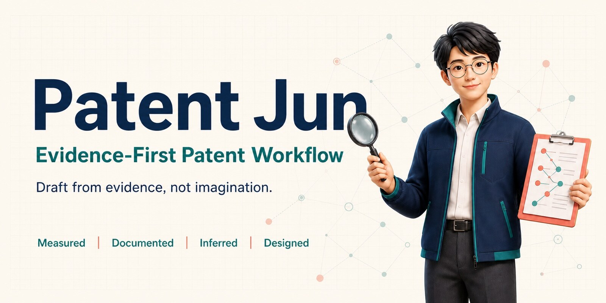
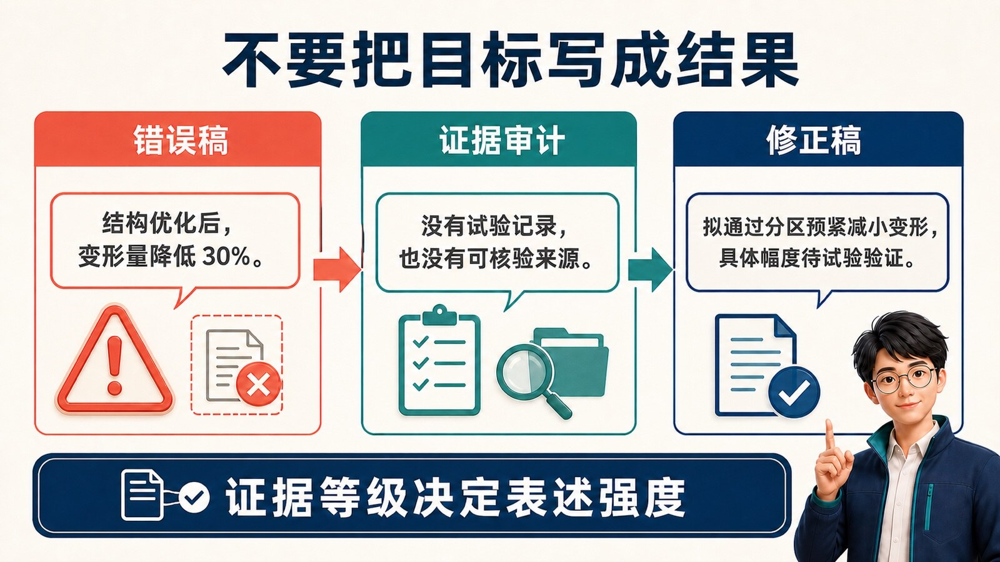
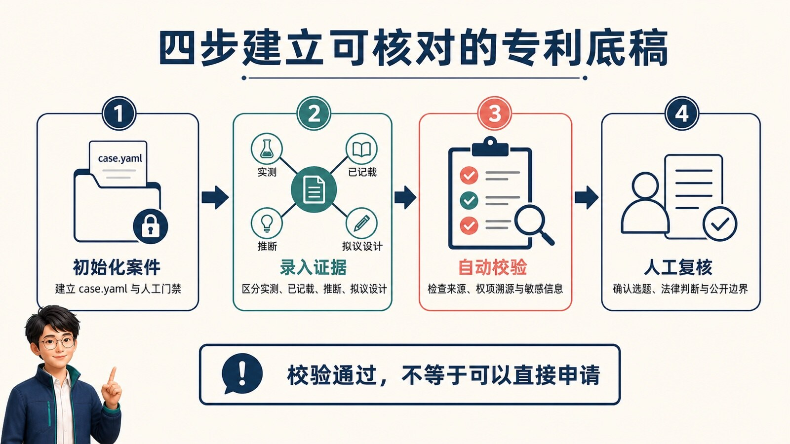
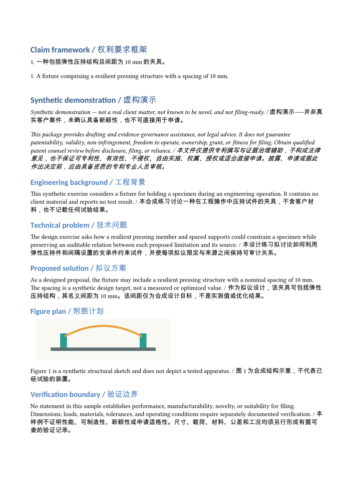
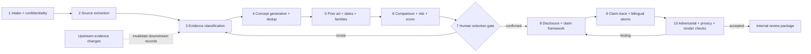
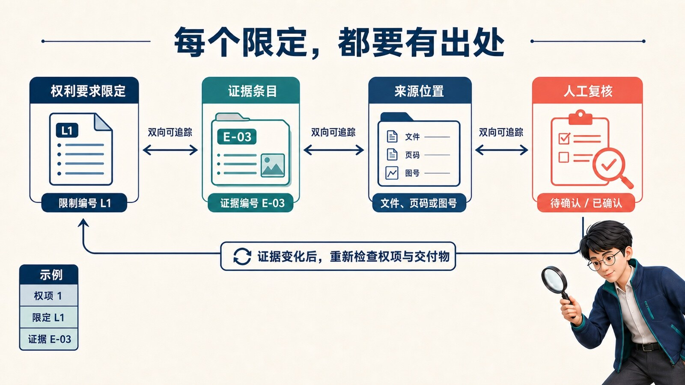
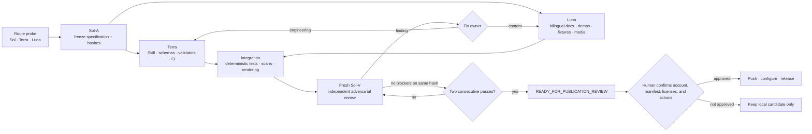

# Evidence-First Patent Skill

**Draft from evidence, not imagination.**



Turn scattered engineering notes, drawings, test records, and public patent documents into a reviewable technical disclosure package with an explicit evidence trail. This Skill covers China (CN) invention and utility-model disclosure work in Chinese, English, or bilingual mode. It separates measured observations, documented statements, inferences, and designed proposals, then requires every claim limitation to trace to evidence or remain visibly subject to human review.

Patent Jun is the workflow's evidence steward and guide, not a patent attorney, agent, examiner, or filing authority.

> The demonstrations are synthetic. They are not client matters, have not received a novelty opinion, and are not filing-ready applications.

This material provides drafting and evidence-governance assistance, not legal advice. It does not guarantee patentability, validity, non-infringement, freedom to operate, ownership, grant, or fitness for filing. Obtain review from qualified patent counsel before disclosure, filing, or reliance.

[Run the three-minute check](#three-minutes-confirm-the-local-workflow) · [Walk through a complete sample](#fifteen-minutes-follow-evidence-to-a-review-package) · [Download a validated release](https://github.com/soarsky1991/evidence-first-patent-skill/releases)

中文主入口：[README.md](README.md) · Legacy Chinese link: [README.zh-CN.md](README.zh-CN.md)

## What it solves

Engineering material often mixes facts, experience, design ideas, and performance targets. Without an evidence pass, a draft can turn “we intend to achieve” into “we achieved,” or introduce a claim limitation with no recorded origin. This project turns those risks into inspectable records and blocking states.

| Typical input | Workflow action | Reviewable output |
|---|---|---|
| Drawings, test records, email, meeting notes | Preserve source locations and verbatim evidence without overwriting originals | `sources.jsonl`, `evidence.jsonl` |
| An engineer's proposed improvement | Classify it as `designed`, never as a measured result | Candidate concepts, verification matrix |
| Public patents and papers | Verify publication dates and deduplicate patent families | Prior-art comparison, risk register |
| Disclosure and claim framework | Split claims into atomic limitations and trace each one | `claim_trace.jsonl`, disclosure draft |
| Chinese and English drafts | Compare objects, relations, numbers, conditions, and dependencies | Conflict records or an atomic-consistency result |

The shortest proof of value is the [bad draft → evidence audit → corrected draft](docs/content/bad-draft-audit-correction.md): an unsupported “30% improvement” is blocked rather than polished into a false result.



## Who it is for—and who it is not for

Good fit:

- engineering teams preparing material for a patent professional;
- patent practitioners who want evidence gaps visible before drafting;
- bilingual teams that must preserve the same technical boundary in both languages;
- projects with incomplete testing that still need proposals and verification targets recorded separately;
- contributors building patent-workflow tests, adapters, and public examples.

Not a fit:

- replacing the judgment of patent counsel, agents, attorneys, or patent offices;
- deciding novelty, inventive step, infringement, freedom to operate, ownership, or inventorship;
- sending unauthorized client, personal, or restricted material to an external service;
- filing applications, publishing undisclosed inventions, or promising grant outcomes.

## How it shows that targets did not become results

The repository does not turn passing tests into a claim about grant rate, drafting quality, or engineering performance. It exposes narrower, reproducible checks:

- every claim limitation has an evidence identifier or an unresolved-review state;
- `unsupported_measured_claims` is zero;
- the same patent family is not counted twice;
- bilingual cases compare technical objects, relations, numbers, conditions, and dependencies;
- synthetic examples, public records, and real project material remain separate;
- automated checks still stop before a human-review gate.

`v0.2.0` remains the Chinese-first, Patent Jun, and external-structure-package baseline. `v0.2.1` adds shared-geometry, movement-state, clean-line, and independent-review gates for multi-view mechanical figures. The case-data `schema_version: 0.1.0` remains unchanged.

## Three ways to use it

### 1. Run the local scripts

Initialization, structural validation, and the sensitive-content scan use only the Python standard library. Clone the repository and begin with the three-minute check below.

### 2. Install it for Codex

Link the Skill into your personal Skills directory, then start a new Codex session:

```sh
mkdir -p ~/.codex/skills
ln -s "$(pwd)/skill/draft-patents-evidence-first" ~/.codex/skills/draft-patents-evidence-first
```

Example request:

> Use `draft-patents-evidence-first`. Inventory the material and run the confidentiality scan first. Stop at the concept-selection gate until I approve the concept and public boundary.

### 3. Install it for Claude Code or another agent

Claude Code can load the same directory from a personal Skills folder:

```sh
mkdir -p ~/.claude/skills
cp -R skill/draft-patents-evidence-first ~/.claude/skills/
```

For another tool that implements Agent Skills, copy `skill/draft-patents-evidence-first/` into its Skills directory. If the tool has no Skills mechanism, require the agent to read [SKILL.md](skill/draft-patents-evidence-first/SKILL.md) in full and follow the ten stages in order. External research, concept selection, publication, and filing still require explicit human gates.

## Three minutes: confirm the local workflow

Requirement: Python 3.11 or a compatible version. This step installs nothing and makes no network request.

```sh
cd evidence-first-patent-skill
python3 skill/draft-patents-evidence-first/scripts/init_case.py ./demo-case --case-id demo-case --language bilingual --patent-type invention
python3 skill/draft-patents-evidence-first/scripts/validate_case.py ./demo-case
python3 skill/draft-patents-evidence-first/scripts/scan_sensitive.py ./demo-case --format json
```

Expected result:

```text
<current-directory>/demo-case
VALID: demo-case (initialized BLOCKED case)
{
  "findings": [],
  "count": 0
}
```

`BLOCKED` is the correct state. The directory is structurally valid, but it contains no evidence and has not passed the human concept-selection gate. Initialization creates this working shape:

```text
demo-case/
├── case.yaml
├── output/
│   ├── claims.md
│   ├── disclosure.md
│   ├── prior_art.md
│   ├── risk_register.md
│   └── verification_matrix.md
└── work/
    ├── sources.jsonl
    ├── evidence.jsonl
    ├── claim_trace.jsonl
    ├── scorecard.json
    └── stage_status.json
```

The next step is to add real source, evidence, gate, and trace records—not to remove the blocking status.



## Fifteen minutes: follow evidence to a review package

Download `BI-PAIR-09.zip` from [Releases](https://github.com/soarsky1991/evidence-first-patent-skill/releases) and place it in the repository root. It is a fully synthetic bilingual case with local source material, evidence records, claim traces, and generated outputs.

```sh
unzip BI-PAIR-09.zip -d demo-bilingual
python3 skill/draft-patents-evidence-first/scripts/validate_case.py ./demo-bilingual
python3 skill/draft-patents-evidence-first/scripts/trace_claims.py ./demo-bilingual --check
python3 skill/draft-patents-evidence-first/scripts/compare_bilingual.py ./demo-bilingual --check
python3 skill/draft-patents-evidence-first/scripts/scan_sensitive.py ./demo-bilingual --format json
python3 skill/draft-patents-evidence-first/scripts/build_package.py ./demo-bilingual --format md --output ./demo-output
```

Key output:

```text
VALID: bi-pair-09 (2 sources, 7 evidence, 2 limitations)
VALID: 100.0% trace coverage (2 limitations)
VALID: 100.0% bilingual atomic consistency (1 pairs)
```

The sensitive scan should report `"count": 0`. The final command creates `demo-output/`, `demo-output/manifest.json`, and `demo-output.zip`; absolute paths vary by machine.

### Output thumbnails from validated samples

The images below come directly from generated synthetic review packages; they are not mock interfaces. They demonstrate the export path, not performance, legal status, or filing readiness.




Read the sample in this order:

1. `case.yaml`: language, patent type, critical date, and confidentiality mode;
2. `input/`: the local source material entering the workflow;
3. `work/sources.jsonl`: provenance, publication dates, licenses, and hashes;
4. `work/evidence.jsonl`: verbatim evidence and its evidence class;
5. `output/claims.md`: the claim framework;
6. `work/claim_trace.jsonl`: the limitation-to-evidence mapping;
7. `work/scorecard.json`: coverage, unsupported measurements, duplicate families, and bilingual consistency.

DOCX/PDF export uses optional dependencies from `requirements-dev.txt` plus LibreOffice or a compatible rendering backend. If no renderer is available, the build exits with status `2`; it does not manufacture a document.

## The patent-case evidence loop



An upstream evidence change invalidates affected downstream records. The workflow never silently preserves a stale claim after the material changes.



## How to tell that a draft is not making things up

Ask four questions:

1. Does every material statement have a source location and evidence record?
2. Does every claim limitation have a resolvable trace?
3. Are targets still phrased as proposed or to be verified, rather than achieved?
4. Is `unsupported_measured_claims` zero?

Conflicts remain visible and block acceptance. Deleting a problem statement is not a valid way to manufacture a pass. Continue with the [audit example](docs/content/bad-draft-audit-correction.md), [data contract](skill/draft-patents-evidence-first/references/data-contract.md), and [claim-to-evidence diagram](public-assets/evidence-provenance.svg).

## Worked examples

| Example | What it teaches | Boundary |
|---|---|---|
| [Synthetic invention](examples/synthetic-invention.md) | How documented structure, designed limitations, and a verification plan stay separate | No real performance result; no novelty opinion |
| [Synthetic utility model](examples/synthetic-utility-model.md) | How product structure and structural relations enter a claim | Method steps are not substituted for structural limitations |
| [Bad draft → audit → correction](docs/content/bad-draft-audit-correction.md) | Why an unsupported “30% improvement” is blocked | The correction still makes no achieved-result claim |
| [Public mechanical records](examples/public-mechanical-case.md) | How to read publication dates, family metadata, and expressly disclosed structural fields | A public record is not a legal-status or novelty conclusion |

See the [example index](examples/README.md). Every example and fixture is synthetic unless it is explicitly marked as a public record.

## FAQ

### 1. Is this a legal service?

No. It is an evidence-organization, drafting, and quality-control tool. Qualified professionals remain responsible for substantive legal and filing decisions.

### 2. Which patent types and jurisdictions are supported?

The first release covers disclosure assistance for China invention patents and utility models. It does not claim filing compliance for other jurisdictions.

### 3. Which languages are supported?

`case.yaml` accepts `zh-CN`, `en-US`, `bilingual`, or `auto`. Bilingual mode compares technical objects, relations, numbers, conditions, and dependencies.

### 4. Why is a new case `BLOCKED`?

An empty case has no evidence, selected concept, or claim trace. The block exposes missing facts; it is not an execution failure.

### 5. What are the four evidence classes?

`measured` requires a method, context, and source location; `documented` is an explicit source statement; `inferred` records a derivation chain; `designed` is a proposal or target.

### 6. Can I use it without test data?

Yes, for documented structure, open questions, proposals, and verification plans. You may not describe a target as a measured result.

### 7. How should a source be recorded?

Record type, locator, date, license, and hash in `sources.jsonl`; preserve verbatim evidence, page or paragraph location, and evidence class in `evidence.jsonl`.

### 8. When may the workflow use the network?

Only after a human approves a sanitized query that removes client, supplier, person, internal-code, and unpublished-parameter identifiers.

### 9. What happens when the languages disagree?

Preserve both texts, mark the pair `conflict`, list the differing technical atoms, and require human resolution. Fluency cannot cure a scope change.

### 10. What is `unsupported_measured_claims`?

It counts statements written as measured results without qualifying measured evidence. A release candidate must report zero.

### 11. Why deduplicate patent families?

One technical disclosure may appear under several publication numbers. Family deduplication avoids double counting, while keeping the provider and verification boundary visible.

### 12. How do the critical date and publication date differ?

The critical date belongs to the matter being evaluated; the publication date belongs to a prior-art record. A date-qualified comparison requires a verified publication before the applicable critical date.

### 13. Can the output be filed as-is?

Not by default. It is an internal review package and claim framework. A qualified professional must review, complete, and decide how it is used.

### 14. What is the difference between local validation and DOCX/PDF export?

Validation checks data, traceability, privacy, and consistency. DOCX/PDF are optional reading formats that still require visual inspection of fonts, tables, numbering, figures, and pagination.

### 15. How can I report a problem or contribute a case?

Use the [Issue templates](.github/ISSUE_TEMPLATE) or read [CONTRIBUTING.md](CONTRIBUTING.md). A public case must document its source, access date, license or redistribution boundary, and privacy review.

## Confidentiality, photographs, and licenses

Cases default to `local_only`, and the compatibility quick check is fully offline. Do not provide unauthorized client material, personal data, or third-party restricted content. Local processing does not itself create attorney-client privilege. See [CONFIDENTIALITY.md](CONFIDENTIALITY.md).

The calliper and bench-vise photographs illustrate measurement and mechanical-fixture contexts only. They are not apparatus from a demo and do not evidence a claimed result. Creator, source, modification, license, and hash records are in the [media ledger](public-assets/media-ledger.md).

- Code, schemas, CI, tests, and automation: [Apache License 2.0](LICENSE).
- Original documentation, narrative examples, diagrams, and generated project media: [CC BY 4.0](LICENSE-DOCS).
- Third-party photographs: their upstream CC BY-SA 4.0 licenses.

## Contributing

Good first contributions include a verifiable public mechanical case, a bilingual terminology improvement, a jurisdiction-writing adapter, or an image-evidence fixture. Run the tests, sensitive-content scan, and media-license validation before opening a PR. Follow [CONTRIBUTING.md](CONTRIBUTING.md) and the [Code of Conduct](CODE_OF_CONDUCT.md).

[Choose a public-case issue](docs/good-first-issues/01-public-mechanical-case.md) · [Improve terminology](docs/good-first-issues/02-bilingual-terminology.md) · [Discuss an adapter](docs/good-first-issues/03-jurisdiction-adapter.md)

## Repository development and acceptance loop

This loop describes how the repository is built; it is not third-party certification. Sol, Terra, Luna, and Sol-V are internal automation roles. Any content change resets the relevant acceptance evidence.



## Reference map

- [Ten-stage workflow](skill/draft-patents-evidence-first/references/workflow.md)
- [Data interfaces and scorecard](skill/draft-patents-evidence-first/references/data-contract.md)
- [Bilingual limitation review](skill/draft-patents-evidence-first/references/bilingual-review.md)
- [Counsel-facing structure package](skill/draft-patents-evidence-first/references/external-structure-package.md)
- [Mechanical figure-set consistency](skill/draft-patents-evidence-first/references/mechanical-figure-consistency.md)
- [Bilingual terminology](docs/content/terminology.md)
- [Patent Jun voice and visual-copy guide](docs/brand/patent-jun.md)
- [Release notes](RELEASE_NOTES.md) / [中文发布说明](RELEASE_NOTES.zh-CN.md)
