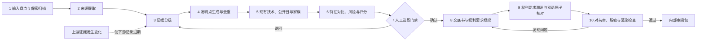
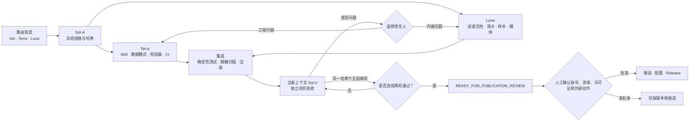

# 专利君｜证据优先专利工作流

**从证据出发，不把目标写成结果。**


把会议纪要、图纸、测试记录和公开专利中的信息，整理成可核对、可追溯、可交给专业人员继续审阅的技术交底资料。这个 Skill 用于中国发明和实用新型案件的交底辅助，支持中文、英文和双语案件；它会区分实测、已记载、推断和拟议设计，并要求每项权利要求限定都能追溯到来源，或者明确标为待审核方案。

专利君是这套工作流的证据核对员和路线向导，不是专利代理师、律师或审查员。

> 虚构演示并不是真实客户案件，尚未进行新颖性判断，也不是可直接提交的申请文件。

本工具仅提供专利撰写与证据治理辅助，不构成法律意见，也不保证可专利性、有效性、不侵权、自由实施、权属、授权或适合直接申请。披露、申请或据此作出决定前，应由具备资质的专利专业人员审核。

[先跑 3 分钟自检](#3-分钟确认本地工作流可用) · [用 15 分钟看完整样例](#15-分钟从证据走到可审阅包) · [下载已验收版本](https://github.com/soarsky1991/evidence-first-patent-skill/releases)

English: [README.en.md](README.en.md) · 旧中文链接兼容页：[README.zh-CN.md](README.zh-CN.md) · [案例索引](docs/cases/README.md) · [贡献](CONTRIBUTING.md) · [跨仓导航](docs/cross-repo-navigation.md)

## 它解决什么问题

工程资料里经常同时出现事实、经验判断、设计设想和性能目标。若不先分清这些陈述，草案很容易把“希望达到”写成“已经实现”，或让一项权利要求找不到出处。本项目把这类风险变成可以检查的数据和状态：

| 常见输入 | 工作流如何处理 | 可审阅输出 |
|---|---|---|
| 图纸、试验记录、邮件、会议纪要 | 保存来源位置和原文证据，不覆盖原件 | `sources.jsonl`、`evidence.jsonl` |
| 工程师提出的改进设想 | 标为“拟议设计”，不冒充实测结果 | 候选发明点、验证矩阵 |
| 公开专利和论文 | 核验公开日，按专利族归并 | 现有技术对比、风险表 |
| 交底书与权利要求框架 | 拆成原子限定并逐项溯源 | `claim_trace.jsonl`、交底书草案 |
| 中英文版本 | 比对对象、关系、数值、条件和从属关系 | 双语冲突记录或一致性结果 |

最直观的例子是：[“定位精度提高 30%”如何被证据审计拦下，并改成待验证陈述](docs/cases/30-percent-audit.md)。


## 适合谁，不适合谁

适合：

- 需要把研发资料交给专利代理师继续处理的工程团队；
- 希望在撰写前看清证据缺口的专利专业人员；
- 同时维护中英文技术边界的跨语言团队；
- 暂无完整试验数据，但希望把方案和验证目标分开记录的项目；
- 想为专利工作流、法域适配器或公开案例贡献代码和样本的开发者。

不适合：

- 用来替代专利代理师、律师或审查机构的专业判断；
- 直接判断新颖性、创造性、侵权、自由实施或权属；
- 把未经授权的客户资料、个人信息或受限材料发送给外部服务；
- 自动提交申请、公开未披露方案，或承诺授权结果。

## 它怎样证明自己没有“把目标写成结果”

仓库不把“测试通过”包装成授权率、撰写质量或工程效果。它只提供可重复核对的技术指标：

- 每项权利要求限定都必须有证据编号，或明确保留待确认状态；
- `unsupported_measured_claims` 必须为零；
- 同一专利族不重复计数；
- 双语案件按技术对象、关系、数值、条件和从属关系逐项核对；
- 合成样例、公开记录和真实项目资料必须分开管理；
- 自动检查通过后仍停在人工复核门前。

`v0.2.0` 保留为中文主入口、“专利君”视觉和对外结构包基线；`v0.2.1` 增加多视图机械附图的同源建模、运动状态、净线验收和独立复核门禁。案件数据的 `schema_version: 0.1.0` 保持不变。

## 三种使用方式

### 1. 直接运行本地脚本

仓库内的初始化、校验和敏感信息扫描只依赖 Python 标准库。克隆仓库后即可运行下面的 3 分钟自检。

### 2. 安装到 Codex

将 Skill 目录链接到个人 Skill 目录，然后重新启动 Codex 会话：

```sh
mkdir -p ~/.codex/skills
ln -s "$(pwd)/skill/draft-patents-evidence-first" ~/.codex/skills/draft-patents-evidence-first
```

之后可以直接说：

> 请使用 `draft-patents-evidence-first`，先盘点材料并做保密扫描；在我确认选题前不要进入实质撰写。

### 3. 安装到 Claude Code 或其他 Agent

Claude Code 可把同一目录放入个人 Skills 目录：

```sh
mkdir -p ~/.claude/skills
cp -R skill/draft-patents-evidence-first ~/.claude/skills/
```

对支持 Agent Skills 规范的其他工具，复制 `skill/draft-patents-evidence-first/` 到其 Skills 目录即可。若工具没有 Skills 机制，可让 Agent 先完整阅读 [SKILL.md](skill/draft-patents-evidence-first/SKILL.md)，再按其中的十阶段顺序工作；外部检索、选题确认、公开和提交仍须保留人工门禁。

## 3 分钟：确认本地工作流可用

要求：Python 3.11 或兼容版本；本步骤不安装依赖，也不联网。

```sh
cd evidence-first-patent-skill
python3 skill/draft-patents-evidence-first/scripts/init_case.py ./demo-case --case-id demo-case --language bilingual --patent-type invention
python3 skill/draft-patents-evidence-first/scripts/validate_case.py ./demo-case
python3 skill/draft-patents-evidence-first/scripts/scan_sensitive.py ./demo-case --format json
```

预期看到：

```text
<当前目录>/demo-case
VALID: demo-case (initialized BLOCKED case)
{
  "findings": [],
  "count": 0
}
```

`BLOCKED` 不是报错。它表示目录结构有效，但尚未录入证据，也没有通过人工选题门禁。初始化后会得到：

```text
demo-case/
├── case.yaml
├── output/
│   ├── claims.md
│   ├── disclosure.md
│   ├── prior_art.md
│   ├── risk_register.md
│   └── verification_matrix.md
└── work/
    ├── sources.jsonl
    ├── evidence.jsonl
    ├── claim_trace.jsonl
    ├── scorecard.json
    └── stage_status.json
```

下一步不是删除 `BLOCKED`，而是给来源、证据、选题确认和权利要求溯源补齐真实记录。


## 15 分钟：从证据走到可审阅包

从 [Releases](https://github.com/soarsky1991/evidence-first-patent-skill/releases) 下载 `BI-PAIR-09.zip`，放到仓库根目录。该样例是完全合成的双语案件，包含本地来源、证据记录、权利要求溯源和预生成输出。

```sh
unzip BI-PAIR-09.zip -d demo-bilingual
python3 skill/draft-patents-evidence-first/scripts/validate_case.py ./demo-bilingual
python3 skill/draft-patents-evidence-first/scripts/trace_claims.py ./demo-bilingual --check
python3 skill/draft-patents-evidence-first/scripts/compare_bilingual.py ./demo-bilingual --check
python3 skill/draft-patents-evidence-first/scripts/scan_sensitive.py ./demo-bilingual --format json
python3 skill/draft-patents-evidence-first/scripts/build_package.py ./demo-bilingual --format md --output ./demo-output
```

关键输出应包括：

```text
VALID: bi-pair-09 (2 sources, 7 evidence, 2 limitations)
VALID: 100.0% trace coverage (2 limitations)
VALID: 100.0% bilingual atomic consistency (1 pairs)
```

敏感扫描应返回 `"count": 0`。最后一条命令会生成 `demo-output/`、`demo-output/manifest.json` 和 `demo-output.zip`；实际绝对路径因电脑而异。

### 已验收样例的产物缩略图

下列图片直接取自已生成的合成样例审阅包，不是模拟界面。它们只证明导出链路能够生成可阅读文档，不证明性能、法律状态或可申请性。


建议按这个顺序阅读样例：

1. `case.yaml`：语言、案型、临界日和保密模式；
2. `input/`：进入工作流的本地来源材料；
3. `work/sources.jsonl`：来源、公开日、许可和文件散列；
4. `work/evidence.jsonl`：逐字证据及 `measured/documented/inferred/designed` 分类；
5. `output/claims.md`：权利要求框架；
6. `work/claim_trace.jsonl`：每项限定如何回到证据；
7. `work/scorecard.json`：证据覆盖、无依据实测陈述、家族重复和双语一致性。

要生成 DOCX/PDF，请先安装 `requirements-dev.txt` 中的可选依赖，并准备 LibreOffice 或兼容渲染器；缺少渲染后端时，构建命令以退出码 `2` 明确停止，不会伪造文档。

## 专利案件的证据闭环



任何上游证据变化都必须让受影响的下游记录变为过期状态。工作流不会在材料改变后悄悄沿用旧权利要求。


## 怎样确认草案没有编造结果

先问四个问题：

1. 每条实质性陈述是否有来源位置和证据记录？
2. 每项权利要求限定是否有可解析的溯源？
3. 性能目标是否仍写成“拟”“待验证”，而非已经达到的结果？
4. `unsupported_measured_claims` 是否为零？

冲突应保留并阻断验收，不能靠删掉问题陈述制造“通过”。进一步阅读：[错误稿审计](docs/content/bad-draft-audit-correction.md)、[数据接口](skill/draft-patents-evidence-first/references/data-contract.md)、[权利要求—证据图](public-assets/evidence-provenance.svg)。

## 案例

| 案例 | 用来学习什么 | 明确边界 |
|---|---|---|
| [合成发明案例](examples/synthetic-invention.md) | 已记载结构、拟议设计和验证计划如何分开 | 没有真实性能结果，不判断新颖性 |
| [合成实用新型案例](examples/synthetic-utility-model.md) | 产品结构及其关系如何进入权利要求 | 不把方法步骤当成结构限定 |
| [错误稿→审计→修正稿](docs/content/bad-draft-audit-correction.md) | 无依据的“提高 30%”为什么必须被拦下 | 修正稿仍不声称已经达到效果 |
| [公开机械记录阅读练习](examples/public-mechanical-case.md) | 如何读取公开日、家族元数据和明示结构字段 | 公开记录不等于法律状态或新颖性结论 |

[查看全部合成示例](examples/README.md) · [案例索引与 3 分钟体验](docs/cases/README.md)。示例与 fixture 除明确标为公开记录者外均为合成内容。

## 常见问题

### 1. 这是法律服务吗？

不是。它是证据整理、草拟和质量检查工具，最终判断仍由具备相应资质的专业人员作出。

### 2. 支持哪些案型和法域？

首版只规范中国发明专利和实用新型专利的交底辅助，不宣称适用于其他法域的正式申请。

### 3. 支持哪些语言？

`case.yaml` 可选 `zh-CN`、`en-US`、`bilingual` 或 `auto`。双语模式会核对技术对象、关系、数值、条件和从属关系。

### 4. 为什么初始化后就是 `BLOCKED`？

因为空目录没有证据、选题确认和权利要求溯源。阻断状态是在提醒你补齐事实，不是运行失败。

### 5. 四类证据怎样区分？

`measured` 是有方法、背景和来源位置的实测；`documented` 是来源明确记载；`inferred` 是可说明推导链的推断；`designed` 是拟议方案或目标。

### 6. 没有试验数据还能用吗？

可以记录结构、问题、拟议方案和验证计划，但不能把性能目标写成实测结果。

### 7. 怎样记录来源？

在 `sources.jsonl` 记录来源类型、定位、日期、许可和散列；在 `evidence.jsonl` 保存逐字证据、页码或段落位置及证据分类。

### 8. 什么时候可以联网检索？

只有在人工确认脱敏查询后。查询中应移除客户、供应商、人员、内部代号和未公开参数组合。

### 9. 双语版本冲突怎么办？

保留两种文本并标为 `conflict`，列出不一致的技术原子，交给人工确认；不能靠“译得更顺”掩盖范围变化。

### 10. `unsupported_measured_claims` 是什么？

它统计被写成实测结果、却没有合格实测证据的陈述。可交付候选中该值必须为零。

### 11. 为什么要按专利族去重？

同一技术可能以多个公开号出现。按家族归并可避免把同一来源重复计数，但家族标识本身仍须记录数据提供方和核验边界。

### 12. 临界日与公开日有什么区别？

临界日来自拟评估案件；公开日来自现有技术记录。只有经核验且早于临界日的公开记录，才能进入相应日期口径的比较。

### 13. 输出可以直接提交申请吗？

不可以默认这样使用。输出是内部审阅材料和权利要求框架，必须经过专业人员审阅、补充并作申请决策。

### 14. DOCX/PDF 与本地校验各做什么？

本地校验检查数据、溯源、敏感信息和一致性；DOCX/PDF 是可选的阅读载体，还需实际打开检查字体、表格、编号和分页。

### 15. 如何报告问题或贡献案例？

请使用 [Issue 模板](.github/ISSUE_TEMPLATE) 或阅读 [贡献指南](CONTRIBUTING.md)。公开案例必须提供来源、访问日期、许可或再分发边界，并完成脱敏。

## 保密、照片与许可

案件默认保持 `local_only`，3 分钟本地检查完全离线。不得提供未经授权的客户材料、个人信息或第三方受限资料。本地处理本身不会自动形成律师—客户保密特权，详见[保密政策](CONFIDENTIALITY.md)。

仓库中的游标卡尺和台虎钳照片仅说明工程测量与机械夹持场景，不属于演示装置，也不能证明任何权利要求效果。创作者、来源、修改说明和散列见[媒体许可台账](public-assets/media-ledger.md)。

- 代码、数据模式、CI、测试和自动化：[Apache License 2.0](LICENSE)；
- 原创文档、叙事性示例、图示和仓库生成媒体：[CC BY 4.0](LICENSE-DOCS)；
- 第三方照片：依各自上游 CC BY-SA 4.0 条款使用。

## 参与贡献

可以从四类小任务开始：新增可核验的公开机械案例、补充双语术语、增加法域写作适配器、改进图像证据 fixture。提交前请运行测试、敏感扫描和媒体许可校验，并遵守 [CONTRIBUTING.md](CONTRIBUTING.md) 与 [CODE_OF_CONDUCT.md](CODE_OF_CONDUCT.md)。

[选一个 good first issue](docs/good-first-issues/01-public-mechanical-case.md) · [补充术语](docs/good-first-issues/02-bilingual-terminology.md) · [讨论法域适配](docs/good-first-issues/03-jurisdiction-adapter.md)

维护者公开身份：马智辰（Zhichen Ma / 智辰老师）。联系：soarhigh1991@gmail.com；X：[@AI2studio](https://x.com/AI2studio)。

## 项目开发与验收闭环

下面这条闭环解释仓库本身如何开发，不是第三方认证。Sol、Terra、Luna 和 Sol-V 只是内部自动化职责；候选内容一旦改变，就必须重新验收。



## 内容导航

- [十阶段工作流](skill/draft-patents-evidence-first/references/workflow.md)
- [数据接口与指标](skill/draft-patents-evidence-first/references/data-contract.md)
- [双语审核](skill/draft-patents-evidence-first/references/bilingual-review.md)
- [对外结构包](skill/draft-patents-evidence-first/references/external-structure-package.md)
- [机械附图组一致性](skill/draft-patents-evidence-first/references/mechanical-figure-consistency.md)
- [双语术语表](docs/content/terminology.md)
- [“专利君”人格与视觉文字规范](docs/brand/patent-jun.md)
- [发布说明](RELEASE_NOTES.zh-CN.md) / [English release notes](RELEASE_NOTES.md)
- [完整案例索引](docs/cases/README.md)
- [跨仓导航](docs/cross-repo-navigation.md)
- [社交预览登记](docs/assets/README.md)
